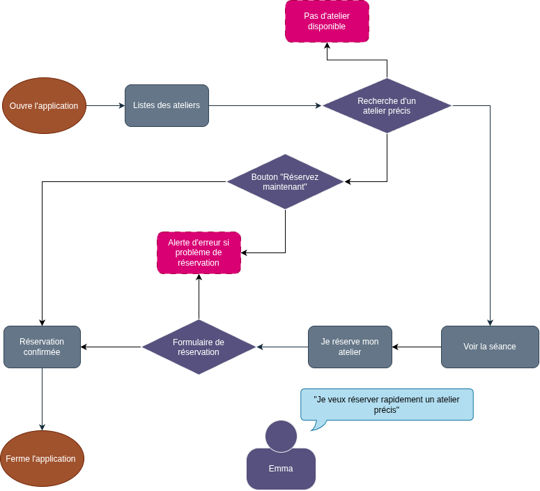

  <h1>Tournevis repair café</h1>
  
  
Le frontend d'un site web simple pour une assocation qui organise un Repair café.

<!-- About the Project -->
## :star2: À propos du projetp

**Règles :**

- **Travail individuel.** Vous pouvez échanger des idées, pas du code.
- **Pas de maquette Figma aujourd'hui.** Vous passez du user flow au code, avec un simple découpage en blocs sur papier.
- **HTML et CSS uniquement**, sans framework ni bibliothèque, sans JavaScript.
- **Cours, slides, documentation et IA autorisés**, à condition de l'indiquer dans le README : quel outil, pour quoi faire.
- **Vous devez pouvoir expliquer chaque ligne de votre code.** Une ligne que vous ne savez pas expliquer ne compte pas.

<!-- Roadmap -->
## :compass: Roadmap

* [X] **Étape 1 : Le persona** -
Créez un persona principal pour Tournevis
* [X] **Étape 2 : Le userflow** -
Dessinez le parcours de votre persona pour l'objectif "Réserver une séance pour réparer son objet"
* [X] **Étape 3 : Le découpage en bloc** -
Croquis rapide de la version mobile et de ses différents éléments
* [ ] **Étape 4 : Le HTML** -
4 pages en HTML sémantique pur sans CSS
* [ ] **Étape 5 :** Le CSS mobile first -
CSS orienté mobile 
* [ ] **Étape 6 :** Le responsive -
Le site doit être responsive sur des écrans plus grands.

<!-- Etape 1 -->
## :one: Étape 1 : Le persona

    <h2>Emma a 37 ans. Elle connaît bien l'association et participe souvent à des ateliers de TOURNEVIS quand elle a un appareil spécifique à réparer.</h2>
    

<!-- Etape 2 -->
## :two: Étape 2 : Le userflow

    
    
Emma est pressé et sait ce qu'elle veut. Pour faciliter son usage, je prends les trois décisions suivantes :

    <ul>
        <li>une champ de recherche avec des filtres pour trouver rapidement son atelier</li>
        <li>un bouton "Réserver maintenant" sur la carte de l'atelier pour Emma qui connaît déjà bien TOURNEVIS</li>
        <li>un écran d'alerte quand la réservation nécessite des conditions précises (matériel nécessaire pour l'atelier par exemple)   </li>
    </ul>

